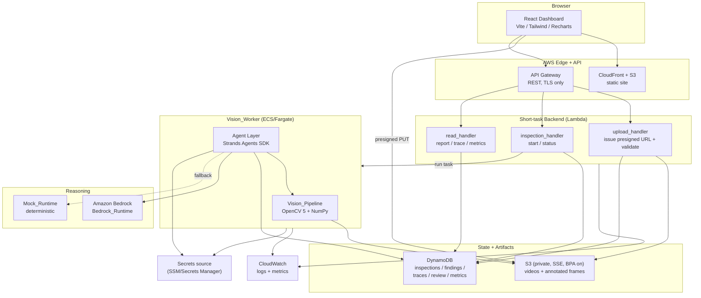
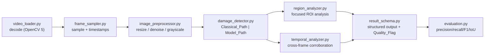
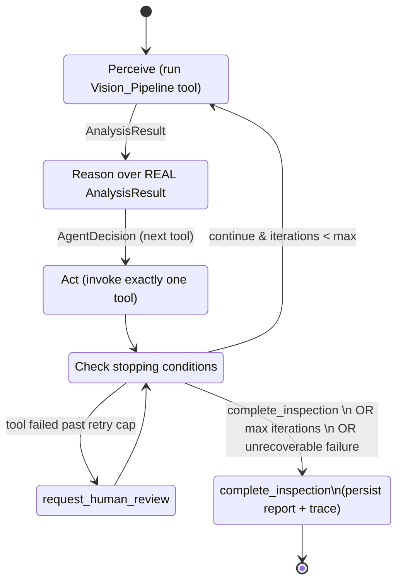
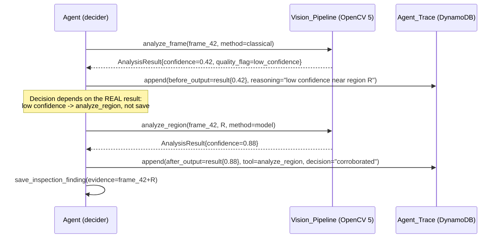

# Design Document

## Overview

RoadGuard AI is an agentic road-safety inspection platform. It ingests a road video, runs a real OpenCV 5 vision pipeline, and drives a bounded reasoning agent that interprets genuine vision output to decide the next action. The architecture is a polyglot monorepo with three cooperating subsystems:

- A **TypeScript frontend** (React + Vite + Tailwind + Recharts) that provides upload, inspection, agent-trace, report, and metrics views.
- A **Python vision pipeline** built on OpenCV 5.x and NumPy, split into modular components with two detection paths (classical CV and ONNX DNN model).
- A **Python agent layer** built on the Strands Agents SDK, defaulting to Amazon Bedrock as its runtime and falling back to a deterministic Mock_Runtime when AWS credentials are absent.

The platform is deployed to AWS as infrastructure-as-code (CDK or CloudFormation). Short tasks run in Lambda, OpenCV processing runs in a containerized Vision_Worker on ECS/Fargate, durable state lives in DynamoDB, video and evidence artifacts live in a private S3 bucket, and Bedrock provides agent reasoning. The whole perception-decision-action loop and its automated tests can run locally with mocks and no AWS credentials.

The central design constraint - and the competition's defining criterion - is that **real OpenCV 5 output must materially change a subsequent agent tool call**. Every downstream design decision (the trace schema, the Mock_Runtime contract, the data flow, the persistence model) exists to make that causal link explicit, observable, and persisted.

### Design Goals Mapped to Requirements

| Goal | Requirements |
| --- | --- |
| Validated, private video intake | 1, 18.2, 18.4 |
| Real OpenCV 5 hybrid pipeline | 2, 4 |
| Honest, non-fabricated reporting | 3, 13.4 |
| Bounded, tool-constrained agent | 5, 6-12 |
| Provable "vision drives action" | 5.6, 14.2, 19.5, Competition 1-3 |
| Structured report + full trace | 13, 14 |
| Measured evaluation | 15 |
| Dashboard | 16 |
| Reproducible AWS IaC deployment | 17 |
| Enforced security controls | 18 |
| Deterministic local mock runtime | 19 |

## Architecture

### Component Diagram



### Service Boundaries

| Boundary | Responsibility | Does NOT do |
| --- | --- | --- |
| Frontend | Presentation, presigned upload PUT, polling status, rendering trace/report/metrics | No detection logic, no AWS SDK writes to DynamoDB |
| API Gateway + Lambda | Auth surface, presigned URL issuance, video validation, inspection control, read APIs | No long-running OpenCV work (Lambda time/memory limits) |
| Vision_Worker (ECS/Fargate) | Long-running OpenCV decode + detection, agent loop orchestration, evidence generation, trace/finding persistence | No direct client exposure |
| Vision_Pipeline (Python module) | Pure(ish) CV functions producing a structured result schema | No agent reasoning, no tool selection |
| Agent layer (Strands) | Perceive-reason-act loop, tool invocation, method selection, stopping conditions | No arbitrary shell/AWS calls outside the seven tools (5.5) |
| DynamoDB | Durable inspection records, findings, agent traces, review queue, metrics | No business logic |
| S3 | Video input + annotated-frame evidence | No public access |

The split between Lambda and Fargate is deliberate: presigned-URL issuance and validation are short and bursty (Lambda), while OpenCV decode/detection across many frames is CPU- and memory-heavy and long-running (Fargate). This satisfies Requirement 17.3 (Vision_Pipeline runs in the containerized Vision_Worker) and keeps Lambda within its execution envelope.

## Components and Interfaces

The system decomposes into four component groups, each with a defined interface. The Vision Pipeline and Agent Layer are specified in detail in their own sections below; this section summarizes the cross-component interfaces.

### Backend API (API Gateway + Lambda)

| Endpoint | Component | Request | Response |
| --- | --- | --- | --- |
| `POST /uploads` | `upload_handler` | `{filename, content_type, size}` | `{upload_url, object_key, expires_in}` presigned PUT (1.1) |
| `POST /inspections` | `inspection_handler` | `{object_key}` | `{inspection_id, status}` after validation (1.2-1.4) |
| `GET /inspections/{id}` | `read_handler` | - | inspection meta + progress (1.5, 13.3) |
| `GET /inspections/{id}/report` | `read_handler` | - | `InspectionReport` (13.1-13.4) |
| `GET /inspections/{id}/trace` | `read_handler` | - | ordered `AgentTrace` (14.1-14.3) |
| `GET /metrics` | `read_handler` | - | aggregate `EvaluationMetrics` (15.2, 15.4) |

### Vision Pipeline Interface

The Vision_Worker invokes the pipeline through a single façade that the agent tools call:

```python
class VisionPipeline(Protocol):
    def analyze_frame(self, frame_ref: str, method: Method) -> AnalysisResult: ...
    def analyze_region(self, frame_ref: str, region: Bbox, method: Method) -> AnalysisResult: ...
    def select_frames(self, criteria: SelectionCriteria, count: int) -> list[FrameRef]: ...
    def compare_evidence(self, evidence_refs: list[str]) -> ComparisonResult: ...
```

All four return the structured types from `result_schema.py`; none ever returns a fabricated detection (3.3, 6.3).

### Agent Interface

```python
class Agent:
    def run_inspection(self, inspection_id: str, video_ref: str) -> InspectionReport: ...
    # internally: perceive -> decider.decide(state, perception) -> invoke one tool -> persist trace
```

The agent depends on the `DeciderService` Protocol (Bedrock or Mock), the `VisionPipeline` Protocol, and a `Store` Protocol (DynamoDB or local fake), so every external dependency is swappable for local, credential-free runs (19.2-19.4).

### Persistence Interface

```python
class Store(Protocol):
    def put_inspection(self, record: InspectionRecord) -> None: ...
    def append_trace(self, inspection_id: str, entry: TraceEntry) -> None: ...
    def put_finding(self, inspection_id: str, finding: InspectionFinding) -> None: ...
    def enqueue_review(self, inspection_id: str, item: HumanReviewItem) -> None: ...
    def put_metrics(self, inspection_id: str, metrics: EvaluationMetrics) -> None: ...
    def get_inspection_bundle(self, inspection_id: str) -> InspectionBundle: ...
```

## Vision Pipeline Design

The pipeline is a set of modular Python components under `vision/`. Each is independently testable and produces or consumes the shared `result_schema` types.



### Component Responsibilities

| Module | Input | Output | Failure behavior |
| --- | --- | --- | --- |
| `video_loader.py` | S3 object ref / local path | `cv2.VideoCapture` handle, container/codec/fps/resolution/duration | Raises `DecodeError`; surfaced as validation failure (1.3) |
| `frame_sampler.py` | capture handle, sampling policy | ordered `Frame` records each with `source_timestamp_ms` | On unreadable frame, emits a frame with a decode `Quality_Flag` (2.5) |
| `image_preprocessor.py` | `Frame` | preprocessed `numpy.ndarray` + quality score | Low quality score propagates a `Quality_Flag` (2.5) |
| `damage_detector.py` | preprocessed frame or region, `method` | `Detection[]` with `bbox_px`, `confidence`, `hazard_type` | On Model_Path load failure, raises `ModelLoadError` for the agent to catch and fall back (4.5) |
| `region_analyzer.py` | frame + region bbox, `method` | region-scoped `Detection[]` | Region outside bounds -> `ValidationFailure` (8.3) |
| `temporal_analyzer.py` | two or more `Evidence`/detections | `ComparisonResult` (agreement/disagreement) | Fewer than two valid items -> `ValidationFailure` (9.3) |
| `result_schema.py` | - | dataclasses/TypedDicts for all vision outputs | N/A (schema definitions) |
| `evaluation.py` | predictions + ground truth | precision, recall, F1, IoU | Empty sets handled as defined known-answers |

### Detection Paths

**Classical_Path** (4.1): Canny edge detection, contour extraction and filtering, morphological open/close to remove noise, and texture analysis (local variance / Laplacian response) to distinguish surface damage from shadows. Produces pixel-space bounding boxes with a heuristic confidence derived from contour strength and texture score.

**Model_Path** (4.2): Loads a **pinned ONNX road-damage model** through the OpenCV DNN module (`cv2.dnn.readNetFromONNX`). The model version, source URL, and verified license are recorded in `vision/models/MODEL_MANIFEST.md` and checked in CI (4.4). Produces bounding boxes and per-detection confidence from the network output.

Both paths detect **potholes and road-surface damage**; **cracks and debris/obstructions** are produced where the active path supports them (4.6). If the pinned model cannot load, `damage_detector.py` raises `ModelLoadError`, the agent records the load failure, and the agent re-invokes the analysis on the Classical_Path (4.5).

### Structured Result Schema (result_schema.py)

```python
# Pixel-based measurement, explicitly labeled (3.1, 3.2)
class Measurement(TypedDict):
    unit: Literal["pixels"]          # always pixel-based
    area_px: int
    width_px: int
    height_px: int
    physical: Literal["unavailable"] # no calibration -> never converted (3.2)

class QualityFlag(TypedDict):
    code: Literal["decode_failure", "low_confidence", "poor_input_quality"]
    detail: str

class Detection(TypedDict):
    hazard_type: Literal["pothole", "surface_damage", "crack", "debris"]
    bbox_px: tuple[int, int, int, int]      # x, y, w, h in pixels
    confidence: float                        # [0.0, 1.0]
    measurement: Measurement

UNAVAILABLE = "unavailable"  # explicit indicator, never fabricated (3.3, 13.4)

class AnalysisResult(TypedDict):
    status: Literal["success", "failed"]     # failed cannot become a finding (2.6)
    method: Literal["classical", "model"]    # recorded for the trace (4.3)
    frame_ref: str
    source_timestamp_ms: int                 # preserved link to video position (2.4)
    detections: list[Detection]              # empty on failure, never fabricated (6.3)
    quality_flags: list[QualityFlag]
    failure_reason: str | None
    evidence_ref: str | None                 # S3 key of annotated frame (2.3)
```

Responsible-use safeguards (Requirement 3) are enforced at the schema level: measurements are always `pixels`-labeled, physical dimensions are the literal `"unavailable"` unless a calibration reference is supplied, and any missing value is the explicit `UNAVAILABLE` sentinel rather than a fabricated number. A `failed` result carries an empty `detections` list by construction, so it cannot be promoted into a successful finding.

## Agent Layer Design

### Runtime Abstraction

The agent's reasoning backend is hidden behind a replaceable `decider_service.py` abstraction so the loop is identical regardless of runtime (19.1-19.3).

```python
class DeciderService(Protocol):
    def decide(self, state: InspectionState, perception: AnalysisResult) -> AgentDecision: ...

class BedrockDecider(DeciderService):   # default, uses Strands + Amazon Bedrock (19.1)
    ...
class MockDecider(DeciderService):      # deterministic fallback (19.2, 19.3)
    ...
# Optional: StrandsDecider is itself a replaceable component plugged into the same Protocol.
```

Runtime selection (19.2): if AWS credentials resolve and `RUNTIME != mock`, use `BedrockDecider`; otherwise use `MockDecider`. The `MockDecider` is a pure function of `(state, perception)` - given identical inputs it returns identical decisions (19.3), and critically it derives its decision **from the real `AnalysisResult`** rather than from fixed detection values (19.5). This is what lets tests prove the agentic criterion without AWS credentials.

### The Seven Agent Tools

Each tool has an input schema, an output schema, and a defined failure behavior (Requirements 6-12). The agent may invoke **only** these seven (5.5).

| Tool | Input | Output | Failure behavior |
| --- | --- | --- | --- |
| `analyze_frame` | `frame_ref`, `method` | `AnalysisResult` (regions, confidences, timestamp, quality flag, method) | `status=failed` + reason, no fabricated detections (6.3) |
| `select_additional_frames` | `criteria`, `count` | ordered `FrameRef[]` with timestamps | empty list + `no_matching_frames` status (7.3) |
| `analyze_region` | `frame_ref`, `region_bbox`, `method` | region `AnalysisResult` | region out of bounds -> validation failure, no analysis (8.3) |
| `compare_visual_evidence` | `evidence_refs[>=2]` | `ComparisonResult` (agreement/disagreement) | fewer than two valid -> validation failure (9.3) |
| `save_inspection_finding` | `hazard_type`, `evidence_ref`, `confidence`, `source_timestamp` | persisted `InspectionFinding` | failed/flag-rejected evidence -> reject, no finding (10.2) |
| `request_human_review` | `observation_ref`, `evidence_ref`, `reason` | `HumanReviewItem` enqueued | validation failure if refs missing |
| `complete_inspection` | inspection id | `InspectionReport` persisted + trace persisted | if no findings/escalations -> report records zero findings (12.3) |

### Bounded Decision Loop



The loop runs exactly one tool per iteration (5.1), enforces a configured max iteration count and per-tool max retry count (5.2), stops on `complete_inspection` / max iterations / unrecoverable failure (5.3, 5.4), and when a tool exhausts retries it records the failure and either escalates via `request_human_review` or completes (5.7). An `InspectionState` carries `iteration`, `max_iterations`, `retries_by_tool`, `findings`, `review_queue`, and `stop_reason`.

### Vision Output Driving the Next Action (the critical criterion)

This is the sequence that must be provable and persisted (5.6, 14.2, 19.5, Competition 1).



The trace entry for a step captures the **before-output**, the reasoning over it, the tool invoked, the **after-output**, and the final decision (14.2). Because the `MockDecider` branches on the real `AnalysisResult.confidence`, `quality_flags`, and `detections`, feeding it two materially different vision outputs at the same decision point yields two different next tool invocations - and both the differing inputs and the differing decisions are written to the persisted trace. That persisted before/decision/after triple is the evidence that satisfies Competition 1 and refutes the "fixed vision + narrative" anti-pattern (Competition 2).

## Data Models

### Entities

**Inspection record** - one per uploaded video (1.4, 5, 13.3).
**Inspection finding** - one per confirmed hazard, references real evidence (10.3, 13.1).
**Agent trace entry** - ordered per iteration (14.1, 14.2).
**Human-review queue item** - escalated observation (11.2, 13.2).
**Evaluation metrics** - per-inspection and aggregate (15).

### Single-Table Design

A single DynamoDB table `RoadGuard` with composite keys, plus GSIs for the read patterns the dashboard needs.

| Entity | PK | SK | Notable attributes |
| --- | --- | --- | --- |
| Inspection | `INSPECTION#<id>` | `META` | status, filename, duration_ms, resolution, fps, upload_ts, progress, stop_reason |
| Finding | `INSPECTION#<id>` | `FINDING#<seq>` | hazard_type, evidence_ref, confidence, source_timestamp_ms, method |
| Trace entry | `INSPECTION#<id>` | `TRACE#<zero-padded-iter>` | perception, reasoning, tool, before_output, after_output, decision, ts |
| Review item | `INSPECTION#<id>` | `REVIEW#<seq>` | observation_ref, evidence_ref, reason, status(open/resolved) |
| Metrics | `INSPECTION#<id>` | `METRICS` | precision, recall, f1, iou, action_accuracy, completion, escalation_rate, latency_ms, failure_rate, aws_cost |

Query patterns:
- Full inspection bundle: `PK = INSPECTION#<id>` returns meta + findings + trace + review + metrics in one query (serves 13.3, 14.3).
- Trace in order: `PK = INSPECTION#<id> AND begins_with(SK, "TRACE#")` - zero-padded iteration preserves ordering (14.1).
- **GSI1 (status/time)**: `GSI1PK = STATUS#<status>`, `GSI1SK = <upload_ts>` for the overview/listing view (16.1).
- **GSI2 (review queue)**: `GSI2PK = REVIEW_STATUS#open`, `GSI2SK = <ts>` for the global human-review queue (11.2, 16).
- **GSI3 (metrics aggregate)**: `GSI3PK = METRICS`, `GSI3SK = <upload_ts>` to aggregate evaluation metrics across inspections (15.2, 16.4).

All items are encrypted at rest; the table enforces encryption and the application retries writes with bounded timeouts (18.3, 18.7).

### Evidence Storage

Annotated frames are written to S3 under `evidence/<inspection_id>/<frame_ref>.png`; findings and trace entries store only the S3 key (`evidence_ref`), keeping DynamoDB items small and resolvable (10.3, 2.3).

## AWS Integration

| Concern | Service | Design |
| --- | --- | --- |
| Static site | S3 + CloudFront | Private bucket, OAC, TLS only |
| API | API Gateway (REST) | TLS only, request validation, throttling |
| Short tasks | Lambda | upload/validate, start/status, read; bounded memory/timeout |
| Upload + evidence | S3 | Private, Block Public Access, SSE, presigned PUT only (18.2, 18.4) |
| Vision processing | ECS/Fargate | Containerized Vision_Worker runs the pipeline + agent (17.3) |
| Durable state | DynamoDB | Single table + GSIs, SSE, point-in-time recovery |
| Reasoning | Amazon Bedrock | Default Agent_Runtime via Strands (19.1) |
| Observability | CloudWatch | Logs + metrics for inspections and tool invocations (18.6) |
| Secrets | SSM Parameter Store / Secrets Manager | Resolved at runtime, nothing hardcoded (18.5) |

The entire stack is defined as an **IaC_Template** (AWS CDK or CloudFormation) provisioning S3, API Gateway, Lambda, DynamoDB, CloudWatch, Bedrock access, and the Fargate Vision_Worker (17.1, 17.2). Deployment, cost, security, and cleanup are documented, and the template supports teardown (17.4, 17.5).

### Processing Flow

1. Client requests an upload; `upload_handler` issues a presigned PUT scoped to one key in the private bucket (1.1).
2. Client PUTs the video directly to S3 over TLS (18.4).
3. On completion, `upload_handler` validates container/codec/duration/size; on failure it records the reason and does not start an inspection (1.2, 1.3); on success it records metadata and creates the inspection record (1.4).
4. `inspection_handler` launches the Fargate Vision_Worker task; progress is reported 0-100 (1.5).
5. The Vision_Worker runs the agent loop: perceive via the pipeline, reason over real output, act via one tool per iteration; findings, trace, review items, and metrics are persisted to DynamoDB; evidence to S3.
6. Read APIs serve report, trace, and metrics by inspection id to the dashboard (13.3, 14.3, 15.4).

## Security and Cost Controls

Security (Requirement 18):
- **Least-privilege IAM per component** (18.1): the upload Lambda can only presign/validate on the input prefix; the Vision_Worker role can read input, write evidence, write its own inspection partition, invoke Bedrock, and emit CloudWatch - nothing more.
- **Private S3 + Block Public Access** on every bucket (18.2).
- **Encryption** at rest (S3 SSE, DynamoDB SSE) and in transit (TLS-only policies on API Gateway, S3, DynamoDB endpoints) (18.3).
- **Presigned-only uploads** (18.4).
- **No hardcoded secrets** - resolved at runtime from the managed secret source; CI secret-scan guards the repo (18.5).
- **CloudWatch** logs and metrics for every inspection and tool invocation (18.6).
- **Bounded retries with timeouts** on all AWS operations, recording failures (18.7).

Cost controls:
- Fargate tasks are sized and time-bounded; the agent's max iteration count caps per-inspection compute (5.2).
- Bedrock is invoked only at reason steps; the Mock_Runtime removes Bedrock cost entirely for local/dev/test runs.
- Per-inspection AWS cost is measured and recorded in the metrics item (15.3) so cost is visible on the dashboard.
- DynamoDB on-demand billing avoids idle provisioned capacity; S3 lifecycle rules expire raw uploads after processing.

## Local Mock Fallback Design

The Mock_Runtime makes the full perception-decision-action loop and all automated tests runnable with no AWS credentials (19.2-19.4, Competition 4).

- **Selection**: a runtime resolver picks `MockDecider` when credentials are absent or `RUNTIME=mock`, else `BedrockDecider` (19.2).
- **Determinism**: `MockDecider.decide` is a pure function of `(InspectionState, AnalysisResult)` with no wall-clock, randomness, or network; identical inputs -> identical decision sequence (19.3).
- **Driven by real vision**: the mock branches on the real `AnalysisResult` fields (confidence thresholds, quality flags, detection counts), so decisions change when vision output changes (19.5). This is the same decision surface the Bedrock runtime reasons over, which keeps the loop identical across runtimes.
- **Local artifacts**: S3 and DynamoDB are backed by in-memory/local fakes in dev/test so the loop runs end-to-end offline. The pipeline still runs **real OpenCV 5** on real sample videos - only the reasoning backend and AWS I/O are mocked.

## Error Handling

| Failure | Detection | Handling | Requirement |
| --- | --- | --- | --- |
| Invalid upload | Validation function | Reject, record reason, no inspection | 1.3 |
| Frame decode failure | `video_loader`/`frame_sampler` | Attach Quality_Flag, continue sampling | 2.5 |
| Low confidence / poor quality | Detector + preprocessor | Attach Quality_Flag; agent may escalate | 2.5, 11.3 |
| Failed vision analysis | `status=failed` in result | Cannot be saved as finding | 2.6, 10.2, Comp 3 |
| Model load failure | `ModelLoadError` | Record failure, fall back to Classical_Path | 4.5 |
| Region out of bounds | `region_analyzer` | Validation failure, no analysis | 8.3 |
| Fewer than 2 evidence | `temporal_analyzer` | Validation failure | 9.3 |
| Tool fails past retry cap | Loop retry counter | Record failure; escalate or complete | 5.7 |
| Unrecoverable failure | Loop | Stop loop, complete with recorded reason | 5.4 |
| AWS op failure | Retry wrapper | Bounded retries + timeout, record failure | 18.7 |
| Missing data value | Schema sentinel | Emit explicit `unavailable` indicator | 3.3, 13.4 |

All failures are written to the agent trace and/or the inspection record so the dashboard surfaces them honestly rather than hiding them.

## Correctness Properties

*A property is a characteristic or behavior that should hold true across all valid executions of a system - essentially, a formal statement about what the system should do. Properties serve as the bridge between human-readable specifications and machine-verifiable correctness guarantees.*

### Property 1: Video validation decision is sound

*For any* video metadata, the validator accepts it if and only if its container, codec, duration, and size all fall within the configured accepted ranges; a rejected video yields a specific non-empty failure reason and creates no inspection record.

**Validates: Requirements 1.2, 1.3**

### Property 2: Successful validation records required metadata

*For any* video that passes validation, the created inspection record contains the source filename, duration, resolution, frame rate, and upload timestamp matching the input.

**Validates: Requirements 1.4**

### Property 3: Progress is bounded

*For any* sequence of progress updates during an inspection, every reported progress value lies within the inclusive range 0 to 100.

**Validates: Requirements 1.5**

### Property 4: Analysis output contract

*For any* successful analysis result (from analyze_frame or analyze_region), the output contains a detections list, a per-detection confidence within [0.0, 1.0], the source frame timestamp, the detection method used, and any quality flags; and the detection timestamp equals the source frame timestamp.

**Validates: Requirements 2.2, 2.4, 6.1, 6.2, 8.1, 8.2, 4.3**

### Property 5: Quality flags on uncertain or failed analysis

*For any* analysis whose confidence is below the configured threshold, or whose input quality is poor, or whose frame could not be decoded, the result carries a Quality_Flag describing the uncertainty or failure.

**Validates: Requirements 2.5**

### Property 6: Failed evidence can never become a finding

*For any* Vision_Pipeline result that is failed or carries a rejecting Quality_Flag, save_inspection_finding rejects the save and no Inspection_Finding is persisted. This also satisfies Competition criterion 3.

**Validates: Requirements 2.6, 10.2**

### Property 7: Responsible-use reporting integrity

*For any* emitted measurement the unit is pixel-based and labeled as such, for any finding lacking a calibration reference the physical dimension fields are the explicit unavailable indicator with no pixel-to-physical conversion, and for any unavailable value the record carries the explicit unavailable indicator rather than a fabricated confidence or measurement or detection.

**Validates: Requirements 3.1, 3.2, 3.3, 13.4**

### Property 8: Model-load failure falls back to the classical path

*For any* analysis in which loading the pinned ONNX model fails, the analysis completes via the Classical_Path and the Agent_Trace records the fallback.

**Validates: Requirements 4.5**

### Property 9: Exactly one tool per iteration

*For any* iteration of the Agent_Loop, exactly one Agent_Tool is invoked, and each trace iteration records perception, reasoning, and that single tool invocation.

**Validates: Requirements 5.1**

### Property 10: Bounded termination

*For any* inspection run the iteration count never exceeds the configured maximum and per-tool retries never exceed the configured maximum, the loop always terminates, and the stop reason is one of complete_inspection, maximum iterations reached with complete_inspection as the terminal tool, or unrecoverable failure.

**Validates: Requirements 5.2, 5.3, 5.4**

### Property 11: Only the seven defined tools are invoked

*For any* Agent_Trace, every invoked tool name is one of the seven defined Agent_Tools and no other operation is executed.

**Validates: Requirements 5.5**

### Property 12: Real vision output changes the subsequent action (critical)

*For any* two inspections that are identical up to a decision point but whose real Vision_Pipeline output differs materially at that point, the Agent's next tool invocation differs accordingly, and the persisted trace entry records the differing before-output, the reasoning, and the resulting decision. This is the critical criterion and also satisfies Competition criteria 1 and 2.

**Validates: Requirements 5.6, 14.2, 19.5**

### Property 13: Tool failure past the retry cap escalates or completes

*For any* Agent_Tool invocation that fails after reaching the maximum retry count, the Agent_Trace records the failure and the following action is request_human_review or complete_inspection.

**Validates: Requirements 5.7**

### Property 14: Additional-frame selection is ordered and timestamped

*For any* selection criteria and frame data, select_additional_frames returns a list ordered by the criterion in which every item carries a source timestamp; when no frames match, it returns an empty list with a no-matching-frames status.

**Validates: Requirements 7.1, 7.2, 7.3**

### Property 15: Region bounds are enforced

*For any* region that is not fully within the frame bounds, analyze_region returns a validation failure and produces no detection output.

**Validates: Requirements 8.3**

### Property 16: Evidence comparison requires at least two items

*For any* compare_visual_evidence invocation, when two or more valid Evidence items are referenced it returns an agreement/disagreement comparison result, and when fewer than two valid items are referenced it returns a validation failure.

**Validates: Requirements 9.1, 9.2, 9.3**

### Property 17: Escalation is preferred over saving for unresolved flagged observations

*For any* observation that carries a Quality_Flag and cannot be resolved within the retry limit, the Agent invokes request_human_review rather than save_inspection_finding, and the resulting Human_Review_Queue item carries the evidence references and a non-empty escalation reason.

**Validates: Requirements 11.1, 11.2, 11.3**

### Property 18: Saved findings reference real evidence

*For any* accepted save_inspection_finding, the persisted Inspection_Finding carries resolvable references to the real Evidence that supports it.

**Validates: Requirements 10.3**

### Property 19: Report completeness

*For any* completed inspection, the Inspection_Report records each finding with its hazard type, evidence references, confidence, and source timestamp; lists each escalated observation with its reason; and when there are no findings and no escalations it explicitly records zero findings.

**Validates: Requirements 12.1, 12.3, 13.1, 13.2**

### Property 20: Report and trace persistence round-trip

*For any* completed inspection, persisting then retrieving the Inspection_Report and the full Agent_Trace by Inspection identifier returns the same content with trace ordering preserved.

**Validates: Requirements 12.2, 13.3, 14.1, 14.3**

### Property 21: Detection metrics are bounded and correct on known answers

*For any* set of predictions and ground-truth annotations, precision, recall, F1, and IoU each lie within [0.0, 1.0]; identical prediction and ground-truth sets yield 1.0, and fully disjoint sets yield 0.0.

**Validates: Requirements 15.1**

### Property 22: Operational rates are bounded and count-consistent

*For any* set of inspections, agent action accuracy, completion rate, and human-review escalation rate each lie within [0.0, 1.0] and equal their count-based definitions.

**Validates: Requirements 15.2**

### Property 23: Bounded AWS retries

*For any* AWS operation that fails, the number of attempts never exceeds the configured retry cap, each attempt is bounded by a timeout, and the failure is recorded.

**Validates: Requirements 18.7**

### Property 24: Mock runtime is deterministic and vision-driven

*For any* given input, running the Mock_Runtime twice produces identical agent decision sequences, and those decisions are a function of the real Vision_Pipeline output such that changing the vision output changes the decisions.

**Validates: Requirements 19.2, 19.3, 19.5**

## Testing Strategy

A dual approach: property-based tests for universal invariants and example/integration/smoke tests for everything that is wiring, UI, infrastructure, or external-service behavior.

**Property tests** (Python: Hypothesis; TypeScript: fast-check). Minimum 100 iterations per property. Each test is tagged `Feature: roadguard-ai, Property {n}: {property_text}` and references its design property.

- Properties 1-5, 7, 14, 15, 16, 21, 22 target pure vision/validation/metric functions with generated inputs.
- Properties 6, 9-13, 17-20, 24 target the agent loop under the deterministic Mock_Runtime with in-memory S3/DynamoDB fakes - no AWS credentials needed (19.4, Competition 4).
- Property 12 (critical) and Property 24 are **metamorphic**: run the loop with two materially different real OpenCV outputs at a decision point and assert the subsequent tool invocation differs and is persisted in the trace.
- Property 8 uses fault injection on model load.
- Property 23 uses fault injection on a mocked AWS client.

**Unit / example tests**: tool input-schema happy paths (10.1), zero-findings completion (12.3), no-match frame selection (7.3), fewer-than-two evidence (9.3), region-out-of-bounds (8.3).

**Integration tests**: real OpenCV 5 decode + sample on 1-3 checked-in sample videos (2.1); annotated-frame generation and S3 evidence storage (2.3); both detection paths producing supported hazard types on labeled samples (4.6); presigned-upload accept vs non-presigned reject (18.4); CloudWatch log/metric emission during an inspection (18.6); per-inspection latency/failure-rate/cost recording (15.3).

**IaC tests**: `cdk synth` snapshot asserting S3/API Gateway/Lambda/DynamoDB/CloudWatch/Bedrock access/Fargate are provisioned (17.2); policy assertions for least-privilege roles (18.1), Block Public Access (18.2), encryption + TLS-only (18.3); destroy supported (17.5).

**Smoke / CI**: classical path stages present (4.1), model path loads pinned model (4.2, 4.4), secret-scan for no hardcoded secrets (18.5), Bedrock default runtime resolution (19.1), and the full Mock_Runtime loop + test suite green with no AWS credentials (19.4, Competition 4).

**Frontend tests**: React Testing Library snapshot/render tests for the overview, inspection, agent-trace, report, and metrics views (16.1-16.4, 15.4), including the agent-trace view rendering the before-output / reasoning / tool / after-output / decision sequence that evidences the critical criterion (14.2).

**E2E**: an end-to-end inspection (upload -> validate -> process real OpenCV -> agent loop -> report + trace + metrics) that demonstrates real OpenCV 5 output changing a subsequent tool call, runnable under the Mock_Runtime for reproducibility (Competition 1, Competition 4).


## Addendum: Single-Runtime Consolidation (video -> AgentCore -> frontend)

> Status: design for the architecture change requested after Milestone 9. Supersedes the Option A split (agent-only on AgentCore, OpenCV on Fargate) with a single managed runtime. Earlier sections describing the Fargate Vision_Worker remain for history; this addendum is the authoritative target.

### Goal

One path, one picture: a user uploads a short road video, Amazon Bedrock AgentCore Runtime runs the REAL OpenCV 5 pipeline AND the Nova-backed reasoning agent in a single container, persists findings/trace/metrics to DynamoDB, and the existing dashboard renders them. No Fargate worker, no second brain.

### Target data flow

1. Client requests a presigned PUT and uploads the video to S3 (unchanged).
2. ``inspection_handler`` (Lambda) creates the inspection META (status=processing) and invokes the AgentCore Runtime asynchronously with ``{inspection_id, object_key, bucket}`` (replaces the never-wired Fargate RunTask).
3. AgentCore Runtime (single container): downloads the video from S3, runs the OpenCV 5 Vision_Pipeline, drives the bounded agent loop with the BedrockDecider (Amazon Nova), and persists trace/findings/review/metrics + a completed META to the DynamoDB single table. Evidence frames go to S3.
4. ``read_handler`` (Lambda) serves overview/report/trace/metrics from DynamoDB. The dashboard polls these and renders the Nova reasoning trace and findings.

Because the dashboard reads only from DynamoDB via read_handler, it is agnostic to what produced the data: moving the writer from Fargate to AgentCore requires NO frontend or read-path change. That is the seam that makes this consolidation low-risk on the presentation side.

### What moves where

| Concern | Before (Option A) | After (single runtime) |
| --- | --- | --- |
| OpenCV 5 decode + detection | Fargate Vision_Worker | AgentCore container |
| Agent loop + 7 tools | Fargate Vision_Worker | AgentCore container |
| Reasoning backend | Bedrock (decision-only service) | Amazon Nova via Strands, in-process |
| Trigger | inspection_handler -> (unwired) RunTask | inspection_handler -> AgentCore InvokeAgentRuntime (async) |
| Persistence (DynamoDB/S3) | Fargate role | AgentCore execution role |
| Dashboard read path | read_handler (DynamoDB) | read_handler (DynamoDB) - unchanged |

### AgentCore entrypoint change

The entrypoint gains a second action alongside the existing ``decide``:

- ``action="inspect"`` with ``{inspection_id, object_key, bucket}``: runs the full pipeline+loop (the same orchestration ``vision/worker_main.py`` performs today) and returns a completion summary. Long-running work runs inside the AgentCore invocation; status/trace are observable in DynamoDB as they are written.
- ``action="decide"`` (existing) and ``action="ping"`` are retained for the decision-only contract and health checks.

The image now bundles OpenCV 5 + NumPy + the vision package (the ``requirements.txt`` "NO OpenCV" constraint is lifted for the consolidated image). The agent/vision code is unchanged source; only the hosting container and the trigger change.

### Reasoning backend: Amazon Nova

The live ``BedrockDecider`` uses ``us.amazon.nova-lite-v1:0`` (inference profile) by default, overridable via ``BEDROCK_MODEL_ID``. Each decision stores the model's own one-line reasoning (prefixed ``Amazon Nova (Bedrock): ...``) in the trace so the dashboard shows genuine LLM reasoning. Tool arguments always come from the perception-validated baseline so every tool call is well-formed; on any Bedrock error the decider falls back to the deterministic MockDecider, keeping the loop bounded and honest.

### Decommission

Once the AgentCore path is verified end-to-end, remove the Fargate/ECS/ECR/VPC-NAT resources and the unused CloudFront dashboard code from the CDK stack, and delete the standalone decision-only runtime. Retain: S3 (upload + evidence), DynamoDB (single table), API Gateway + upload/inspection/read Lambdas, Amplify (dashboard), and the AgentCore Runtime. This is the "remove other deploy things" cleanup and must be explicitly confirmed before any resource is destroyed.

### Trade-offs (honest)

- Per-inspection latency grows to tens of seconds because every reason step calls Bedrock; acceptable for an async, dashboard-polled flow.
- The AgentCore image is larger (OpenCV bundled); offsets the removed Fargate/NAT cost.
- The offline Mock_Runtime backbone and all 36 tests are unaffected: the same vision + agent source runs, only the host and reasoning backend differ.
